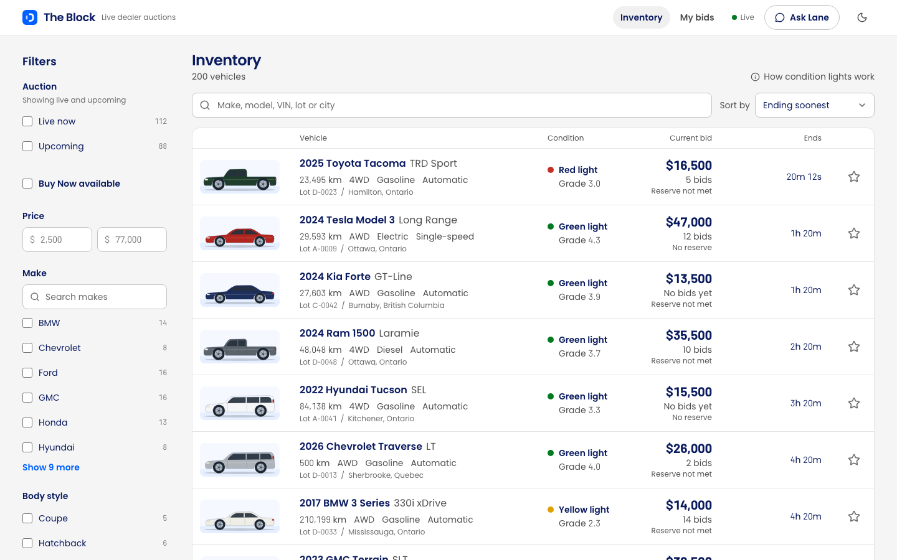
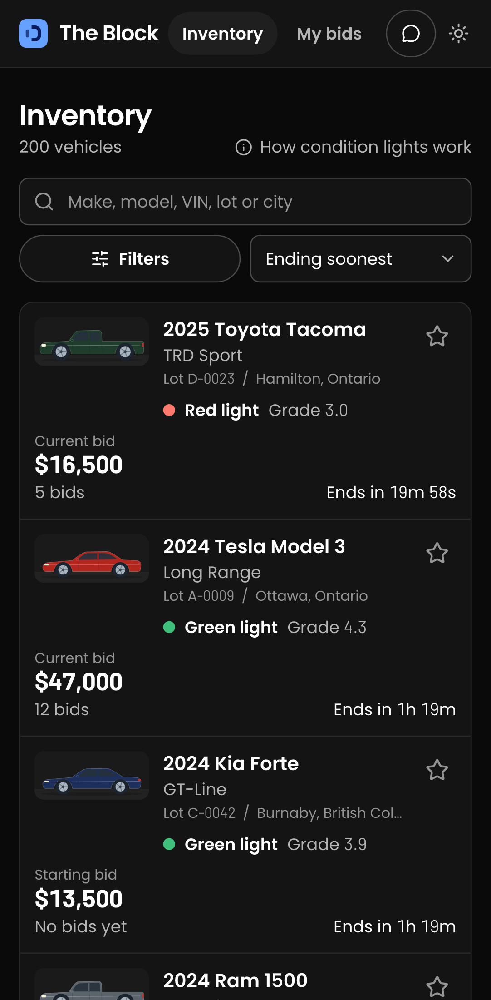
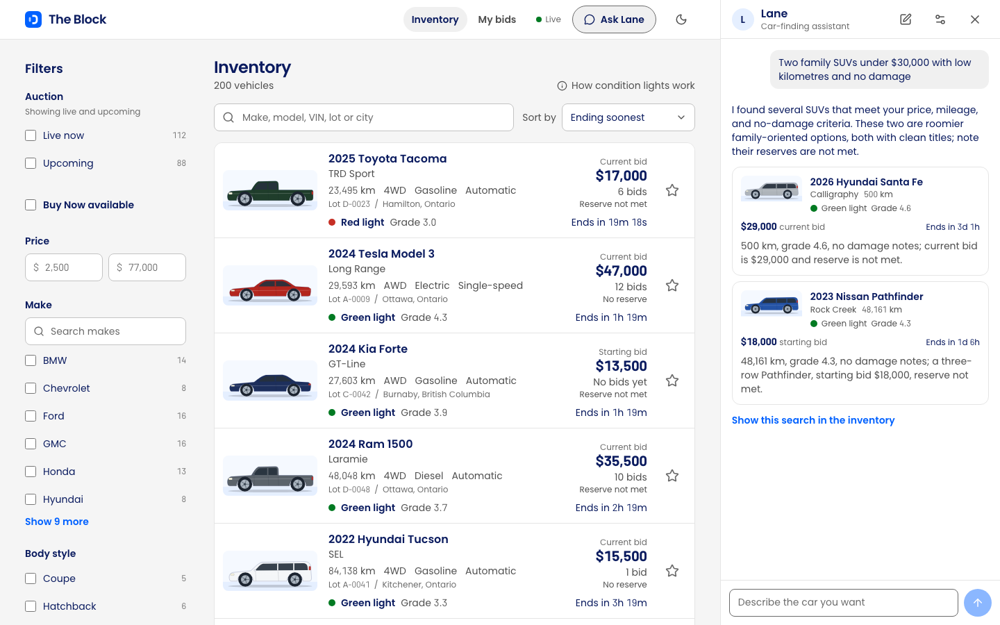
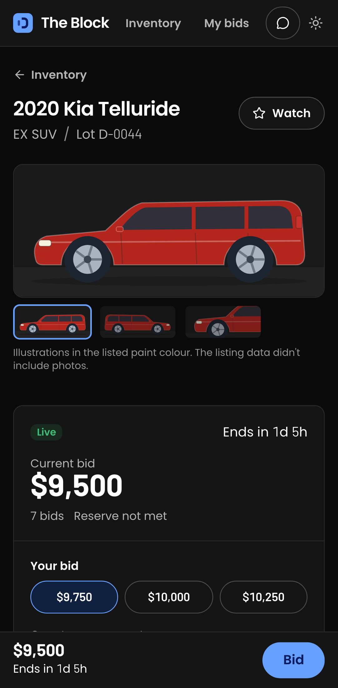

# The Block

The buyer side of a live online car auction, built for the [OPENLANE coding challenge](docs/CHALLENGE.md).
Dealers browse 200 vehicles, check their condition, and bid. Prices change live as other
(simulated) dealers bid, and you're told the moment someone outbids you.



| Vehicle page                                                                      | On a phone (dark theme)                                       |
| --------------------------------------------------------------------------------- | ------------------------------------------------------------- |
|  |  |

| Lane, the car-finding assistant                                             | Vehicle page on a phone                                        |
| --------------------------------------------------------------------------- | -------------------------------------------------------------- |
|  |  |

## How to run

**You need:** Node.js 22 or newer, and [uv](https://docs.astral.sh/uv/getting-started/installation/)
(uv installs the right Python by itself).

```bash
npm run setup   # installs everything
npm run dev     # starts the API on :8000 and the web app on :5173
```

Open **http://localhost:5173**. The database is created and filled from `data/vehicles.json` the
first time it starts. Other dealers start bidding a few seconds later.

| Command                            | What it does                                                                              |
| ---------------------------------- | ----------------------------------------------------------------------------------------- |
| `npm test`                         | Runs the API tests and the web tests                                                      |
| `npm --workspace web run test:e2e` | Runs the browser tests (first run `npx --workspace web playwright install chromium` once) |
| `npm run lint`                     | Checks code style and types                                                               |
| `npm run build`                    | Builds the web app for production                                                         |
| `npm run reset-db`                 | Starts over with fresh data (stop `npm run dev` first)                                    |
| `SIMULATOR_ENABLED=0 npm run dev`  | Runs without the simulated bidders                                                        |

The API's docs are at **http://localhost:8000/docs**.

### Lane, the car-finding assistant (optional)

Lane uses your own ChatGPT account through the
[Codex CLI](https://developers.openai.com/codex/cli) (version 0.163 or newer):

```bash
npm install -g @openai/codex   # or: brew install --cask codex
```

Then click **Ask Lane** in the app and **Sign in with ChatGPT**.

- Lane stays signed in on this computer. Its sign-in is kept in `server/.lane/`, apart from your
  own Codex settings, and it uses your ChatGPT plan.
- The rest of the app works without it. `LANE_ENABLED=0` turns it off.
- If Lane says Codex didn't start, look in `server/.lane/app-server.log`.
- `LANE_CODEX_COMMAND` (default `codex`) and `LANE_HOME` (default `server/.lane`) point Lane at a
  different Codex or sign-in folder.

## Time spent

About 3–4 hours, as the brief asks.

## What I built

- **Inventory.** One row per vehicle, the way auction lists are read. Each row shows the car, its
  main specs, a condition light, the price, a live countdown and where you stand. On wide screens
  it becomes a table, and very wide screens get extra columns instead of empty space. You can
  search (make, model, trim, VIN, lot, city, dealer), filter, sort and page, and all of it is kept
  in the URL, so a link or the back button brings you to the same list.
- **Vehicle page.** Drawings of the car in its real paint colour, the condition report with the
  most important things first (a warning for branded titles, a 1–5 grade, damage sorted by how
  serious it is), the specs with a copyable VIN, and the selling dealer.
- **Bidding.** Pick a suggested amount or type one, then confirm. You can bid on upcoming
  auctions early and use Buy Now. A bid in the last 2 minutes adds time, so others can respond.
  The server refuses bids that are too low, outbid yourself, are far too high by mistake, or go
  past the Buy Now price.
- **Live updates.** Prices change on screen as bids come in, in every open tab. If you're outbid,
  a message pops up with a "Bid again" link. The header shows when the connection drops.
- **My bids.** Your auctions grouped as Outbid, Winning, Watching and Finished, with a count of
  the ones that need you.
- **Lane, the car-finding assistant.** Describe what you want ("an SUV under $30,000 with low
  kilometres, closing today") and Lane picks up to four cars from the inventory. Each comes with
  its live price, its countdown and why it fits, plus a link that opens the same search in the
  inventory. It knows which car you're looking at, can't bid for you, and only suggests cars that
  exist. You choose the model and how hard it thinks.

## Stack

|              |                                                                                                   |
| ------------ | ------------------------------------------------------------------------------------------------- |
| **Frontend** | React 19, TypeScript 7, Vite, Tailwind v4, TanStack Query, React Router, Radix primitives, Motion |
| **Backend**  | Python 3.12, FastAPI, Pydantic, SQLAlchemy 2                                                      |
| **Database** | SQLite                                                                                            |
| **Testing**  | pytest, Vitest + Testing Library, Playwright                                                      |
| **Tooling**  | uv, npm workspaces, ruff, mypy, oxlint, prettier, GitHub Actions                                  |

```
server/   The API: auction rules, bidding, the bidder simulator, loading the data
web/      The web app: pages, components, and an API client typed from the server
data/     vehicles.json, the dataset from the challenge
docs/     The challenge brief and screenshots
```

## Notable decisions

- **Auction times are moved to "now".** The dataset's dates are all in the past. I kept the gaps
  between them and shifted them so the first auction ends 20 minutes after you start the app.
  That gives 112 live and 88 upcoming auctions. When everything has ended, the data starts over
  by itself, so the app works whenever you clone it.
- **Bids before an auction opens.** 43 upcoming cars already have bids in the data. Real
  wholesale auctions take early bids, so the app does too.
- **The reserve price stays secret.** You only see whether it's met, as on real auction sites.
  The amount never leaves the server.
- **Condition lights** (green, yellow, red), like the lights over a real auction lane. They come
  from the title and how serious the damage is, and a legend explains the rule.
- **Two bids at the same moment can't both win.** Bids are handled one at a time on the server.
  A test fires the same bid six times at once, and exactly one goes through. Sending the same bid
  twice by accident (a double click, a retry) only places it once.
- **Honest data.** The dataset has bid counts but no bid history, and 34 cars have more bids than
  their prices allow. I made up histories that follow the bid steps and set the count to match.
- **Fair rival bidders.** They only answer you after 20 seconds and each stops at its own limit,
  so you can win.

## Assumptions and scope

- One buyer per browser, without accounts (the brief allows this).
- The data has no real photos (only placeholder links), so each car is drawn in its body style
  and paint colour, labelled as a drawing.
- Times in the data are UTC. Money is in whole Canadian dollars.
- **Not built, on purpose:** checkout and payment after winning, seller tools, emails or push
  notifications, automatic (maximum) bidding, saved searches.

## Testing

- **API: 180 tests.** Auction rules, the time shift, search and filters, every reason a bid can
  be refused, double-sent bids, the 2-minute extension, Buy Now, two bids at once, live updates,
  and the simulated bidders. Lane is tested against a fake Codex, so no account is needed.
- **Web: 191 tests.** Formatting, filters in the URL, the inventory, the bid flow, live updates,
  the connection shared between tabs, pop-up messages, My bids, and Lane's panel.
- **Browser: 8 tests** on a desktop and a phone screen. Find a car, bid, go back to the list, see
  the bid in My bids. Also: filters on a phone, asking Lane for a car, eight tabs open at once, the
  vehicle page layout at different widths, and the inventory table.
- **By hand in a real browser** (desktop, dark mode, phone width). This caught, for example, a
  search for "ford" that also matched "Oxford White". Lane was tried with a real ChatGPT account.
- **Accessibility:** all text is readable against its background (WCAG AA) in both themes, the
  app works with a keyboard, screen readers hear changes in your standing, and animation is
  turned down when your system asks for less motion.
- Every pull request runs all the checks and tests on GitHub.

## How it was built

I worked with **Claude Code** as an AI pair programmer. I chose what to build, set the rules and
reviewed the work. The agent read the repo and data, wrote code, and ran the reviews and checks.
The work went in as small pull requests, each one built, tested, reviewed, fixed and merged once
all checks passed: see the
[PR history](https://github.com/mohazari/the-block/pulls?q=is%3Apr+is%3Aclosed). The reviews found
real bugs, and each PR lists them.

Design: the [ui-ux-pro-max](https://github.com/nextlevelbuilder/ui-ux-pro-max-skill) and
[taste-skill](https://github.com/Leonxlnx/taste-skill) guides, with colours and the Poppins font
taken from OPENLANE's own site, and [Motion](https://github.com/motiondivision/motion) for
animation.

## What I'd do with more time

- **Automatic (maximum) bidding.** It's how most dealers really bid.
- **Real photos and condition-report pictures**, keeping the drawings as a fallback.
- **Run more than one API server**, with Postgres and a shared channel for live updates.
- **Accounts and notifications** (email or push when you're outbid or a watched car opens).
- **Better search ranking**, so "ford" shows Ford cars before dealers named Ford.
- **What happens after you win:** invoice, transport, and a window to raise problems.
