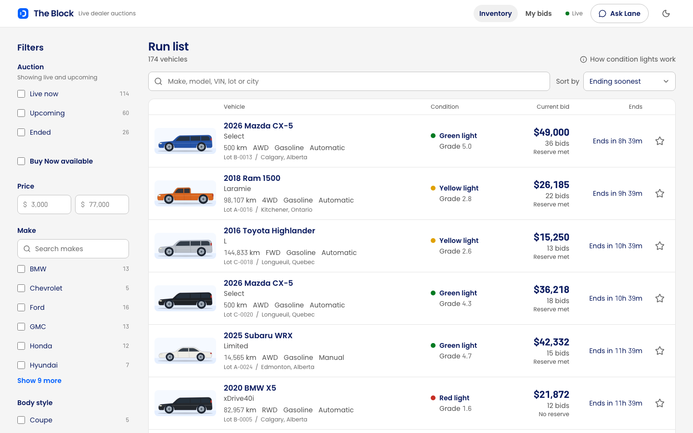
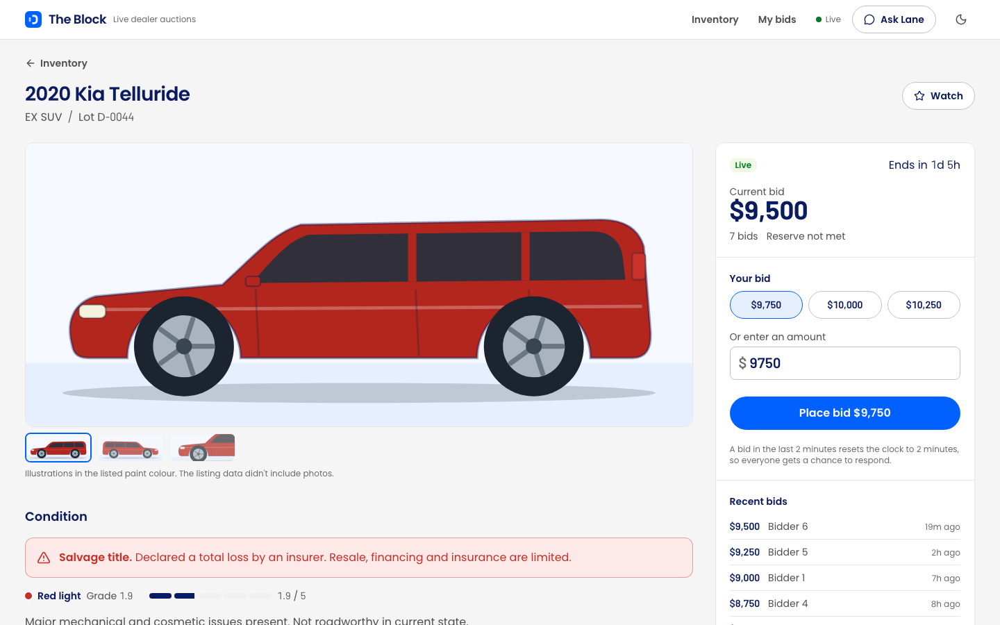
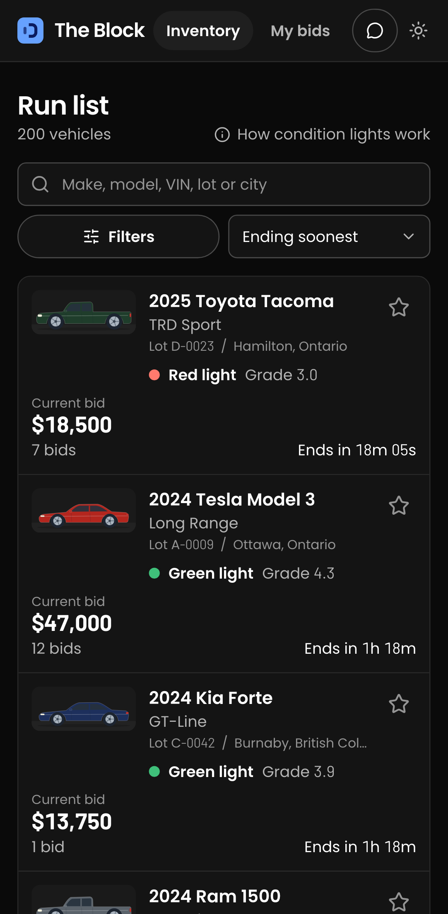

# The Block

The buyer side of a live wholesale vehicle auction, built for the [OPENLANE coding challenge](docs/CHALLENGE.md).
Dealers browse a run list of 200 vehicles, judge condition at a glance, and bid against live
(simulated) competition: prices move in real time, and you're told the moment you're outbid.



| Vehicle detail                                                                                  | On a phone (dark theme)                                     |
| ----------------------------------------------------------------------------------------------- | ----------------------------------------------------------- |
|  |  |

## How to run

**Prerequisites:** Node.js ≥ 22 and [uv](https://docs.astral.sh/uv/getting-started/installation/)
(uv installs the right Python by itself).

```bash
npm run setup   # web dependencies (npm) + API dependencies (uv)
npm run dev     # API on :8000, web app on :5173
```

Open **http://localhost:5173**. The database is created and seeded from `data/vehicles.json` on
first start. Rival dealers start bidding a few seconds later.

| Command                            | What it does                                                                                                 |
| ---------------------------------- | ------------------------------------------------------------------------------------------------------------ |
| `npm test`                         | API tests (pytest) and web tests (Vitest)                                                                    |
| `npm --workspace web run test:e2e` | Playwright end-to-end tests (run `npx --workspace web playwright install chromium` once first)               |
| `npm run lint`                     | ruff + strict mypy, oxlint + tsc + prettier                                                                  |
| `npm run build`                    | Production build of the web app                                                                              |
| `npm run reset-db`                 | Start over: fresh data and a fresh auction clock (stop `npm run dev` first; open tabs resync when it's back) |
| `SIMULATOR_ENABLED=0 npm run dev`  | Turn the rival bidders off                                                                                   |

The API's interactive docs are at **http://localhost:8000/docs**.

### Lane, the car-finding assistant (optional)

Lane answers with your own ChatGPT account, through the
[Codex CLI](https://developers.openai.com/codex/cli) (version 0.163 or newer):

```bash
npm install -g @openai/codex   # or: brew install --cask codex
```

Then click **Ask Lane** in the app and **Sign in with ChatGPT**. Lane stays signed in on this
computer (in `server/.lane/`, separate from your own Codex settings) and uses your ChatGPT plan's
usage. It's meant for local demos. The rest of the app works without it; `LANE_ENABLED=0` turns
it off. If Lane says Codex didn't start, its output is in `server/.lane/app-server.log`.
`LANE_CODEX_COMMAND` (default `codex`) and `LANE_HOME` (default `server/.lane`) point Lane at
another Codex or sign-in folder.

## What I built

- **Run list.** Dense rows, not a card grid, the way auction run lists are read. Each row shows
  the vehicle, key specs, a **condition light**, price, a live countdown, and your standing.
  From 1280px it's a table with aligned, evenly spaced columns (the reserve under the price),
  and wider monitors add columns (odometer, location) instead of empty space. Search (make, model, trim, VIN, lot, city, dealer),
  multi-select filters with live counts (searchable for makes and provinces), sorting, and
  pagination all live in the URL. Filters sit in a rail on desktop and a bottom sheet on phones.
- **Vehicle detail.** Illustrated views in the car's real paint colour, a condition report that
  leads with what matters (branded-title warning, a 1–5 grade meter, damage grouped **major →
  mechanical → cosmetic**), specs with VIN copy, and the selling dealer.
- **Bidding.** Quick amounts or a custom one, validated as you type, then a **two-step confirm**.
  Pre-bids on upcoming auctions, **Buy Now**, a 2-minute **soft close**, and server-side guards
  against bidding below the minimum, outbidding yourself, fat-finger amounts, and bidding past
  Buy Now.
- **Live.** One Server-Sent Events stream updates every price on screen, shared by all open
  tabs (a SharedWorker), so many tabs can't use up the browser's connections to the site. You
  get an **outbid toast** with a "Bid again" link. The header shows when the connection drops.
- **My bids.** Outbid → Winning → Watching → Finished, with a nav badge counting the auctions you
  need to act on.
- **Lane, the car-finding assistant.** Describe what you want in plain words ("an SUV under
  $30,000 with low kilometres, closing today") and Lane picks up to four cars from the run list,
  each with its live price, countdown and the reason it fits, plus a link that opens the same
  search in the run list. It knows which car you're looking at, can't bid for you, and only
  recommends cars that exist. You choose the model and effort. On wide screens it docks beside
  the page; the run list then switches to its narrower layout.

## Stack

|              |                                                                                                   |
| ------------ | ------------------------------------------------------------------------------------------------- |
| **Frontend** | React 19, TypeScript 7, Vite, Tailwind v4, TanStack Query, React Router, Radix primitives, Motion |
| **Backend**  | Python 3.12, FastAPI (with native SSE), Pydantic, SQLAlchemy 2                                    |
| **Database** | SQLite (WAL; `BEGIN IMMEDIATE` for bids)                                                          |
| **Testing**  | pytest, Vitest + Testing Library, Playwright                                                      |
| **Tooling**  | uv, npm workspaces, ruff, mypy (strict), oxlint, prettier, GitHub Actions                         |

```
server/   FastAPI app: domain rules (pure), services, routers, rival simulator, seed
web/      React app: routes, components, typed API client (generated from the server's models)
data/     vehicles.json, the provided dataset (source of truth for seeding)
docs/     Original challenge brief and screenshots
```

## Notable decisions

The ones that shaped the product:

- **Time made relative to now.** The dataset's auction dates are all in the past. The schedule
  keeps their relative spacing, shifted so the first auction closes 20 minutes after startup.
  4-day auctions give a mix of 112 live and 88 upcoming. The data restarts itself once
  everything has closed, so the app works whenever you clone it.
- **Pre-bids.** 43 vehicles that land in "upcoming" already have bids in the data. Wholesale
  lanes accept proxy bids before a car runs, so the app allows them too.
- **The reserve is never revealed**, only whether it's met, as on real platforms. The amount has
  no field in any API response.
- **Condition lights** (green / yellow / red), borrowed from the lights over a physical auction
  lane. They're derived from title status and damage severity, with the rule shown in a legend.
- **Correct under concurrency.** Bids run in one write-locked transaction, and the clock is read
  only after the lock is held. A 6-thread test fires identical bids at once: exactly one wins.
  Idempotency keys make retries safe. On the client, the newest snapshot (by bid count) wins, so
  out-of-order events and refetches can't roll a price back.
- **Data honesty.** The dataset has bid counts but no bid history, and 34 vehicles claim more
  bids than any increment ladder allows (e.g. 11 bids within $500). Synthesized histories obey
  the increments, and the stored bid count follows the history.
- **Rival bidders that are plausible, not rigged.** They counter a human only after 20 seconds,
  stop at a private ceiling (so a determined buyer can win), and go through the same bid rules.

## Assumptions and scope

- One anonymous buyer per browser (a random id in `localStorage`). No accounts, as the brief
  allows.
- The listing data has no photos, so each car is drawn in its body style and paint colour, and
  labelled as an illustration.
- Times in the dataset are treated as UTC. Money is whole dollars (CAD formatting).
- **Deliberately not built:** checkout and payments after winning, seller tools, notifications
  outside the app, proxy (maximum) bidding, saved searches.

## Testing

- **API: 161 pytest tests.** Auction rules, schedule normalization, seeding invariants, search
  and facets, every bid rejection, idempotency, soft close, Buy Now, the concurrency race, SSE
  personalization and backpressure, and simulator behaviour. Lane's tests run against a fake
  Codex (`server/tests/fake_codex.py`), so they never need an account. Warnings are errors.
- **Web: 175 Vitest tests.** Formatting and rules, the API client, the clock sync, URL filter
  state, the run list, the bid flow (two-step confirm, outbid recovery, amount pinning), live
  events through a fake `EventSource`, the stream shared between tabs, toasts, My bids, Lane's
  panel, and the logo matching the browser tab's icon.
- **End to end: 8 Playwright tests** on desktop and a phone viewport. They find a car, bid,
  return to the filtered run list, and see the bid in My bids. They also cover the mobile filter
  sheet, asking Lane for a car and opening its pick, eight tabs open at once, where the vehicle
  page puts the condition report at each width, and the run-list table's columns.
- **Manual QA in a real browser** (desktop, dark mode, 390px): found and fixed the search
  over-matching ("ford" matched "Oxford White"), filter checkboxes reordering under the cursor, a
  cropped illustration, and the animated price lingering on "$13,997". It also confirmed a real
  outbid by a simulated rival end to end.
- **Accessibility:** every text colour meets WCAG AA (4.5:1) on the backgrounds it's used on, in both themes,
  checked by script. Keyboard focus is visible, there's a skip link, live regions announce
  standing changes, toasts pause while hovered or focused, and reduced motion is respected.
- CI runs lint, types, unit and e2e tests on every PR, and fails if the generated API types
  drift from the server.

## How it was built

I worked with **Claude Code** as an AI pair. I set the product direction, constraints and review
bar. The agent analysed the repo and data, drafted code, and ran the reviews and QA. The work
shipped as **nine slices** (setup → domain → inventory API → bidding API → live updates → web
foundation → run list → detail and bidding → live UI). Each slice was built, tested, put through
a code review, fixed, and merged by PR once CI was green: see the
[PR history](https://github.com/mohazari/the-block/pulls?q=is%3Apr+is%3Aclosed). Reviews found
real bugs that every PR description lists, for example a stale clock read before the bid lock,
an idempotency key that could replay a bid as a Buy Now, and a refetch that could roll back a
live price.

Design references: the
[ui-ux-pro-max](https://github.com/nextlevelbuilder/ui-ux-pro-max-skill) skill (its auction
colour semantics and accessibility rules were used; its serif body font and dark-first theme were
rejected for a data-dense tool) and [Motion](https://github.com/motiondivision/motion) for
animation. A later design refresh used the
[taste-skill](https://github.com/Leonxlnx/taste-skill)'s rules for app screens and its
real-browser inspector, and took colours and type from OPENLANE itself: its published palette
and Poppins, with tabular figures from Barlow for prices and countdowns.

## Time spent

Well beyond the suggested 3–4 hours, by choice: the goal was a full-stack version with tested
concurrency and live updates. The slice-by-slice PRs show where the time went.

## What I'd do with more time

- **Proxy (maximum) bidding.** It's how most dealers actually bid, and the bid transaction is
  already the right place for it.
- **Real photos and condition-report media**, with the illustrations kept as the fallback.
- **Postgres and a shared event channel** (`LISTEN/NOTIFY` or Redis) to run more than one API
  process; the code notes where that changes.
- **Accounts and notifications** (email/push when outbid or when a watched car opens).
- **Full-text search with ranking** (SQLite FTS5 or Postgres), so a query like "ford" ranks Ford
  makes above dealers named Ford.
- **Post-auction flow:** what happens after "You won" (invoice, transport, arbitration window).
